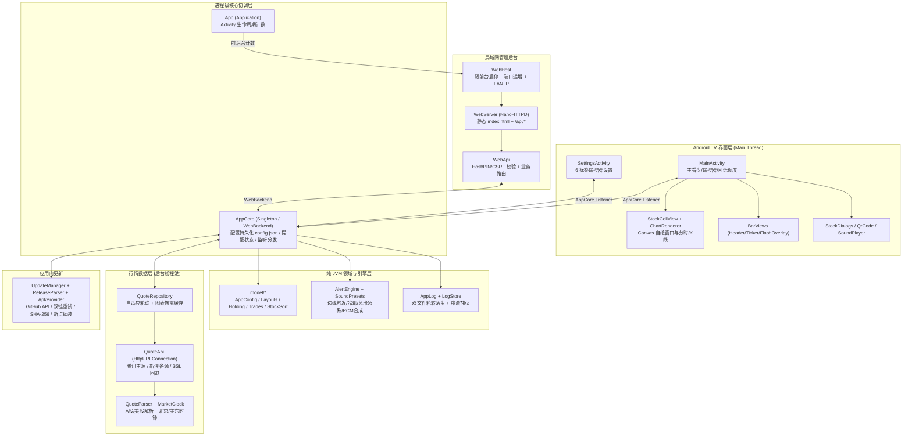

# 仓库代码与架构说明（REPO_GUIDE）

> 本文档面向项目接手与后续开发维护，系统梳理 **电视看盘（`androidtv-stock`）** 的业务定位、技术架构、全部目录与文件职责、核心数据流、测试体系及开发注意事项。面向最终用户的功能与遥控器说明请见 [README.md](README.md)。

---

## 1. 项目概览

- **项目名称**：电视看盘（`androidtv-stock`）
- **远程仓库**：https://github.com/yixuexiaoao/androidtv-stock（`origin`）
- **应用包名**：`io.github.yixuexiaoao.tvstock`
- **当前版本**：`1.3.0`（见 `VERSION`）
- **核心定位**：运行在 Android TV / 电视盒子（兼顾手机/平板）上的 A 股与美股行情监控应用。
- **核心能力**：
  - 遥控器全功能 D-pad 操作，支持 1~16 宫格、多种监控式不规则分屏（1大2小、1大5小等）及 Web 端可视化自定义布局。
  - 图文、分时图、日/周/月 K 线、纯文字 4 种展示模式；放大详情页含五档盘口（美股为一档）与财务/行情指标。
  - 本地持仓记账（加仓摊薄成本、减仓/清仓累计已实现盈亏、支持撤销，无真实交易功能）与按市场分离的持仓汇总。
  - 多条件到价/涨跌幅/持仓盈亏/涨跌停/急涨急跌提醒，支持窗口闪烁、全屏闪烁、顶部横幅、PCM 实时合成提示音自由组合，带冷却、每日一次及持续重复机制。
  - 内嵌局域网 HTTP 管理后台（随前台界面自动启停，不在后台常驻），支持自选股管理、拖拽画布局、导入导出、实时日志查看与远程触发更新。
  - 基于 GitHub Releases 的应用内自更新（含 ABI 自动匹配、SHA-256 与包名校验、授权后进程重启自动续装）。

### 1.1 技术栈与设计哲学

| 维度 | 选型与特点 |
| --- | --- |
| **语言与平台** | 纯 Kotlin（2.0.21），Android SDK（`minSdk 21` / `targetSdk 34` / `compileSdk 35`），JDK 17 |
| **依赖极简主义** | **零 AndroidX / Compose / Coroutines / OkHttp / Retrofit**，全量 UI 均使用原生 Android View + Canvas 手绘，降低 APK 体积并保障低配电视盒子流畅度 |
| **第三方依赖** | 仅 2 个运行时库：`org.nanohttpd:nanohttpd:2.3.1`（内嵌 Web 服务）、`com.google.zxing:core:3.5.3`（局域网地址二维码）；测试依赖 `junit:4.13.2`、`org.json:20240303` |
| **可测试性边界** | 核心业务（模型、布局、行情解析、提醒引擎、记账、排序、Web API 路由、更新解析、日志存储）全部解耦为**纯 Kotlin / JVM 代码**，不依赖 Android Framework，可直接跑本地 JVM 单元测试 |
| **前端后台** | 单文件零构建 `app/src/main/assets/web/index.html`（原生 HTML + CSS + ES6 JS），无 npm/打包链路 |

---

## 2. 系统架构与核心数据流



### 2.1 线程与生命周期模型

1. **进程与 Web 服务生命周期（`App.kt` + `WebHost.kt`）**：
   - `App.WebLifecycle` 统计可见 `Activity` 数量（`visible`）。只要 App 在前台（主界面或设置页），`WebHost` 运行 NanoHTTPD 并允许 `QuoteRepository` 轮询；一旦按主页键、退出或进入系统屏保导致 `visible == 0`（排除配置变更），立即停止 Web 服务并暂停行情定时唤醒，不留任何后台常驻 Service。
2. **数据更新与 UI 刷新流**：
   - `QuoteRepository` 在单线程调度器 `scheduler` 中轮询行情（交易时段按 `refreshSec`，休市按 `idleRefreshSec`，连续失败指数退避至 60s），在 3 线程 `chartPool` 中按需异步拉取当前屏幕可见股票的分时/K 线。
   - 拿到报价后在后台线程调用 `AlertEngine.evaluate(...)` 产出 `AlertEvent`，再切回主线程通过 `AppCore.Listener` 通知 `MainActivity`。
   - 多窗口图表并发回包通过 `AppCore` 150ms 防抖合并（`CHARTS_COALESCE_MS`）为一次界面刷新；`StockCellView` 绑定前做脏检查，数据未变跳过重绘。
3. **配置读写一致性（`AppCore.kt`）**：
   - 所有修改方法均加 `@Synchronized`，内存 `cfg` 为 `@Volatile` 不可变数据类；写盘通过单线程 `io` 执行器先写 `config.json.tmp` 再原子重命名为 `config.json`。

---

## 3. 仓库目录与文件详解

### 3.1 根目录与构建/发布配置

| 文件路径 | 作用与用途 |
| --- | --- |
| `VERSION` | 基础语义化版本号（当前 `1.2.0`）。被 `app/build.gradle.kts` 和 CI 工作流读取，正式发布打 `v<VERSION>` 标签时必须与之严格一致。 |
| `README.md` | 面向最终用户的使用文档：核心功能、遥控器按键表、美股说明、Web 后台安全提示、安装、更新机制、源码构建与已知限制。 |
| `CHANGELOG.md` | 版本演进记录。**注意**：CI 发布 Release 时会通过 `awk` 自动抽取 `## <VERSION>` 段落并剔除 `测试与验证`、`未解决问题`、`开源参考` 子节，作为 App 更新弹窗展示给用户的更新说明。 |
| `settings.gradle.kts` | Gradle 根配置，声明仓库源与单模块 `:app`。 |
| `build.gradle.kts` | 顶层插件版本管理（AGP `8.7.3`、Kotlin Android `2.0.21`）。 |
| `gradle.properties` | JVM 堆内存（2GB）、UTF-8 编码、Gradle 缓存及 `nonTransitiveRClass` 开关。 |
| `gradlew` / `gradlew.bat` / `gradle/wrapper/*` | Gradle Wrapper 脚本与配置。 |
| `signing/sideload.keystore` | 仓库内置的公开侧载签名证书（口令/别名见 `app/build.gradle.kts`），用于在未配置私有 CI Secrets 时保持签名稳定以支持覆盖升级。 |
| `.github/workflows/build.yml` | GitHub Actions 全自动流水线，包含 3 个阶段：`build`（单测 + Release 分 ABI 构建 + 低版本更新探针包 `0.0.1-probe.1`）→ `smoke`（Android TV API 30 模拟器真机级冒烟测试，截图推送至 `ci-screens` 孤儿分支）→ `release`（`main` 发 Pre-release，`v*` 标签发正式版）。 |
| `scripts/ci-smoke.sh` | 443 行端到端冒烟测试脚本，通过 `adb` + `curl` 验证：低版本 App 内自更新全链路、旧版本覆盖升级保留持仓、端口 58080、Web API/CSRF/记账撤销、真实 A 股/美股拉取、多布局/主题/隐私/提醒截图、遥控器交互、前后台 Web 启停及崩溃/错误日志零检出。 |
| `.claude/launch.json` | 之前使用 Claude 开发时遗留的本地调试配置（指向临时目录的 `mock.py`，已失效），接手后无需依赖，可视情况清理。 |
| `.gitignore` / `.gitattributes` | Git 忽略规则与换行符属性配置。 |

### 3.2 `app/` 模块配置与资源

| 文件路径 | 作用与用途 |
| --- | --- |
| `app/build.gradle.kts` | 模块构建脚本：动态版本号与 `versionCode` 计算（支持 `STOCK_VERSION_NAME`/`GITHUB_RUN_NUMBER`/`STOCK_VERSION_CODE` 环境变量）、私有/公开签名切换、`armeabi-v7a` + `arm64-v8a` + `universal` ABI 分包、R8 代码与资源压缩、精简依赖声明。 |
| `app/proguard-rules.pro` | R8 混淆规则，保留 `fi.iki.elonen.**`（NanoHTTPD）。 |
| `app/src/main/AndroidManifest.xml` | 声明网络/Wi-Fi/开机启动/安装未知应用权限；配置双桌面入口（`LAUNCHER` 与 `LEANBACK_LAUNCHER`）、横屏锁定、`MainActivity`（`singleTask`）、`SettingsActivity`、`ApkProvider`（私有授权 APK 共享）与 `BootReceiver`。 |
| `app/src/main/res/xml/network_security_config.xml` | 网络安全策略：默认禁止明文 HTTP，仅对 `gtimg.cn` 和 `sinajs.cn` 放行 HTTP 回退（兼容老电视根证书过期或系统时间错乱）。 |
| `app/src/main/res/values/strings.xml` | 应用名称（`电视看盘`）。 |
| `app/src/main/res/values/styles.xml` | 全屏无标题栏黑底主题（`Theme.Material.NoActionBar.Fullscreen`）。 |
| `app/src/main/res/drawable/ic_launcher.xml` | 应用矢量启动图标。 |
| `app/src/main/res/drawable-xhdpi/banner.png` | Android TV Leanback 桌面横幅图（含“电视看盘”字样）。 |
| `app/src/main/assets/web/index.html` | 局域网 Web 管理后台单页应用（949 行，零外部依赖）：涵盖顶部快捷栏、6 个标签页（自选股与持仓记账、预设与拖拽自定义布局编辑器、显示设置、提醒设置与测试/历史、系统配置与导入导出/版本更新、实时日志查看与下载）、PIN 密码认证与自动轮询同步。 |

### 3.3 Kotlin 源代码（`app/src/main/java/io/github/yixuexiaoao/tvstock/`）

#### A. 入口与全局核心

| 文件 | 核心类/对象 | 职责与用途 |
| --- | --- | --- |
| `App.kt` | `App`、`WebLifecycle` | `Application` 入口。按顺序初始化日志、全局未捕获异常钩子、`AppCore`、`UpdateManager`，并注册 `ActivityLifecycleCallbacks` 以控制 `WebHost` 随前后台启停。 |
| `AppCore.kt` | `AppCore` | 进程级核心单例，同时实现 `WebBackend` 接口，作为 TV UI 与 Web 后台的唯一共享事实源（Single Source of Truth）。负责 `config.json` 读写、行情回调转发、触发并缓存最近 200 条提醒、管理活跃提醒、静音计时、防抖合并图表刷新事件。 |
| `BootReceiver.kt` | `BootReceiver` | 监听 `ACTION_BOOT_COMPLETED`，若用户开启 `autostart` 则尝试拉起 `MainActivity`（捕获 Android 10+ 后台启动限制异常并记日志）。 |

#### B. 数据模型与业务计算（`model/`，纯 JVM 无 Android 依赖）

| 文件 | 核心类/对象 | 职责与用途 |
| --- | --- | --- |
| `model/Models.kt` | `Markets`、`StockCodes`、`StockConfig`、`DisplayModes`、`AlertModes`、`AppSettings`、`Themes`、`AppConfig`、`Quote`、`MinutePoint`、`KLine`、`SearchHit`、`AlertEvent` | 定义全量配置与行情实体，以及 JSON 序列化/反序列化、安全范围裁剪（`merged`）、旧配置兼容迁移（如旧端口 `8080` → `58080`、旧买入价合并为 `costPrice`）、A 股/美股/美股指数代码标准化（`StockCodes.normalize`）、自动白天/夜晚主题时段解析（`Themes.resolve`）、闪烁频率光敏安全下限（200ms）。 |
| `model/Layouts.kt` | `GridCell`、`GridLayoutDef`、`Layouts` | 定义 16 种内置分屏布局（1/2/3/4/6/8/9/12/16 等分及 7 种监控式不规则分屏）、自定义网格合法性校验（最大 12×12、越界与重叠检测）、数字键映射与分页切片工具。 |
| `model/Holding.kt` | `Holding`、`PortfolioSummary` | 纯函数计算单只股票持仓市值、持仓盈亏/盈亏率、今日盈亏，以及按市场汇总的总持仓、今日盈亏与累计已实现盈亏（含已清仓标的）。 |
| `model/Trades.kt` | `TradeError`、`TradeRecord`、`Trades` | 本地持仓记账引擎：支持加仓（加权平均摊薄成本）、减仓、清仓（不改成本、差价入已实现盈亏、清零后清空成本）与逐笔撤销（最多保留最近 50 笔快照）。 |
| `model/StockSort.kt` | `StockSort` | 支持 5 种盯盘排序模式（自选顺序、涨幅降序、跌幅降序、涨跌幅绝对值异动优先、今日持仓盈亏绝对值优先），无行情标的置底。 |

#### C. 行情抓取与时钟（`data/`）

| 文件 | 核心类/对象 | 职责与用途 |
| --- | --- | --- |
| `data/MarketClock.kt` | `MarketClock` | 独立于电视本机时区，分别以 `Asia/Shanghai` 和 `America/New_York`（自动夏令时）判断 A 股与美股交易时段、盘中防屏保时段及盘面状态文案（未开盘/集合竞价/盘前/交易中/午休/盘后/已收盘/结合最新行情日期推断节假日休市）。 |
| `data/QuoteApi.kt` | `QuoteApi` | 基于原生 `HttpURLConnection`（复用持久连接避免反复 TLS 握手）封装腾讯（主）与新浪（备）公开行情接口：批量报价（50 只/批）、A 股/美股分时、前复权 K 线、代码/拼音搜索；具备 `SSLException` 自动降级 HTTP 及 `AUTO` 模式失败切新浪机制。 |
| `data/QuoteParser.kt` | `QuoteParser` | 纯函数解析器：解析腾讯 A 股/美股报价（`~` 分隔）、新浪 A 股/美股报价（`,` 分隔与 `gb_` 代码映射、美东时间戳转换）、分时序列、K 线 JSON（自动过滤开盘前开高低为 0 的异常行）及搜索建议（含 Unicode 解码与市场过滤）。 |
| `data/QuoteRepository.kt` | `QuoteRepository` | 行情轮询与内存缓存仓库。智能计算多市场刷新间隔（交易中高频、非交易低频、后台降频、断网指数退避至 60s），非当前且休市市场降频轮询；按 `wantMinute`/`wantKline` 并发拉取图表（盘中分时 20s / K 线 5min，休市均 15min，失败冷却 30s）。 |

#### D. 提醒引擎与合成音（`alert/`）

| 文件 | 核心类/对象 | 职责与用途 |
| --- | --- | --- |
| `alert/AlertEngine.kt` | `AlertEngine` | 边缘触发式提醒判断引擎：支持目标价、下破价、涨跌幅、持仓盈亏比、涨跌停（A 股）、滑动时间窗急涨急跌 10 类条件；支持“每次穿越+冷却”、“每天一次”、“条件持续满足周期重复”、仅交易时段生效及区分上涨/下跌方向。 |
| `alert/SoundPresets.kt` | `SoundPresets` | 内置 8 种提示音方案（三音上升/下降、清脆两声、低沉两声、单响、双响、急促警报、无声），实时合成 22050Hz 16-bit 单声道正弦波 PCM（带淡入淡出包络防爆音），跨设备听感一致。 |

#### E. 电视原生界面（`ui/`）

| 文件 | 核心类/对象 | 职责与用途 |
| --- | --- | --- |
| `ui/MainActivity.kt` | `MainActivity` | 主看盘界面与全局遥控器事件中枢：动态按 `GridLayoutDef` 定位多宫格 `StockCellView`、顶部市场切换与设置按钮焦点锁定、点击放大详情与返回还原、长按弹出快捷菜单、自动翻页轮播、OLED 防烧屏像素微移、按交易时段控制亮屏、全屏/横幅/窗口闪烁调度、首次启动引导与自动更新检查弹窗触发。 |
| `ui/SettingsActivity.kt` | `SettingsActivity` | 电视端 6 标签设置页（画面、外观、行情、提醒、自选股、系统）。针对遥控器优化：标签聚焦即切换内容、设置项上左右键改值并锁焦、频道键快捷切换标签、试听提示音、自选股添加/排序/启停/记账/删除与手动检查更新。 |
| `ui/StockCellView.kt` | `StockCellView` | 单个股票行情自绘 View：根据窗口宽高与 `fontScale` 自适应信息密度，支持纯文字、图文/分时/K 线窗口及放大详情模式（左图右五档盘口与 12 项指标），支持价格跳动瞬时微闪（350ms）、涨跌停角标、距目标价百分比、隐私模式脱敏与焦点/报警边框高亮。 |
| `ui/ChartRenderer.kt` | `ChartRenderer` | 无依赖 Canvas 图表绘制引擎：分时图（A 股 241 点 / 美股 391 点、昨收对称中轴、面积填充、均价线、成交量柱）与 K 线图（自适应可见根数、蜡烛图、MA5/10/20 均线、成交量柱），均支持绘制目标价/下破价/成本价水平虚线标记。 |
| `ui/BarViews.kt` | `HeaderView`、`TickerView`、`FlashOverlayView` | 三个专用自绘 View：顶部状态栏（指数优先排版防遮挡、分市场持仓汇总、后台地址、页码、盘面状态、延迟与静音提示、时钟）、底部平滑滚动行情条（脏标记缓存测宽、隐藏时降频）、全屏闪烁报警遮罩层。 |
| `ui/StockDialogs.kt` | `StockDialogs` | 遥控器友好的原生弹窗集合：编辑持仓、单股提醒规则、加仓/减仓/清仓记账（带实时成本与盈亏预览）、撤销记账、后台地址二维码、使用帮助、新版本更新提示与最近提醒列表。 |
| `ui/Palette.kt` | `Palette`、`Format` | 主题配色方案（深色/纯黑/深蓝/白天/夜晚低亮度/自动按时间切换，按 `主题|涨跌色` 缓存避免反复解析）与数字/价格/成交量/成交额/盈亏货币格式化工具（自动区分 A 股人民币与美股美元、屏蔽美股指数无意义成交额）。 |
| `ui/QrCode.kt` | `QrCode` | 封装 ZXing `QRCodeWriter` 生成 `RGB_565` 二维码位图。 |
| `ui/SoundPlayer.kt` | `SoundPlayer` | 缓存 `SoundPresets` 生成的 PCM 数据，通过原生 `AudioTrack`（`MODE_STATIC`）播放并在播完后自动释放资源。 |

#### F. 局域网 Web 后台（`web/`）

| 文件 | 核心类/对象 | 职责与用途 |
| --- | --- | --- |
| `web/WebHost.kt` | `WebHost` | Web 服务宿主管理器：监听配置端口变化、端口冲突时自动向上探测最多 50 个端口、后台线程定期扫描网卡获取最新局域网 IPv4 地址并发布至 `AppCore.webUrl`。 |
| `web/WebServer.kt` | `WebServer` | `NanoHTTPD` 子类：托管缓存后的静态 `web/index.html` 与 `/api/*` 请求；附加安全响应头（`nosniff`、`DENY`、`no-referrer`、`no-store`）、1MB 请求体上限、PIN 校验失败 800ms 延迟防暴力破解，以及优先选取 `eth`/`wlan` 局域网 IPv4。 |
| `web/WebApi.kt` | `WebBackend`、`ApiRequest`、`ApiResponse`、`WebApi` | 纯 JVM REST API 处理器。内置三道安全防线：**Host 头白名单**（仅限 IP / localhost，防 DNS 重绑定）、**常时间比较 `X-Pin`**、**写接口强制校验 `X-Requested-With: androidtv-stock`**（防 CSRF）。完整路由见第 4 节。 |

#### G. 应用内更新（`update/`）

| 文件 | 核心类/对象 | 职责与用途 |
| --- | --- | --- |
| `update/UpdateManager.kt` | `UpdateManager` | 更新状态机（`IDLE → CHECKING → AVAILABLE/UP_TO_DATE → DOWNLOADING → READY/ERROR`）：按更新渠道拉取 GitHub Releases（仅正式版走 `/latest` 避免被海量预发布淹没）、优先走 GitHub API 资源地址失败回退 `browser_download_url` 并支持两轮重试、下载后校验文件大小 + SHA-256 + APK 包名、通过 `update.pending` 标记（6 小时有效）解决首次授权未知来源时系统杀进程导致的中断问题，重开 App 自动续装。 |
| `update/ReleaseParser.kt` | `ReleaseInfo`、`Versions`、`ReleaseParser` | 纯函数解析 GitHub Releases JSON：过滤草稿、按设备 ABI 优先选包并回退 `universal`、提取 `sha256:` 摘要、Markdown 更新说明转纯文本、语义化与预发布版本号比较（`0.2.0 > 0.2.0-pre.9 > 0.2.0-pre.8`）及用户可读的网络异常文案映射。 |
| `update/ApkProvider.kt` | `ApkProvider` | 非导出只读 `ContentProvider`（authority `${applicationId}.apk`），仅暴露 `update.apk` 给系统包安装器（Android 7+ 使用 `content://` 替代 `file://`）。 |

#### H. 日志与崩溃捕获（`log/`）

| 文件 | 核心类/对象 | 职责与用途 |
| --- | --- | --- |
| `log/AppLog.kt` | `AppLog` | 全局日志门面：同时写入 `logcat`（前缀 `TvStock/`）与 `LogStore`；支持 `verbose` 开关控制 `D` 级日志；安装未捕获异常处理器落盘崩溃堆栈；约定**不记录访问密码、持仓数量、金额与备注**。 |
| `log/LogStore.kt` | `LogStore`、`LogEntry` | 轻量持久化日志存储：每条立即追加写盘（防崩溃丢日志），单文件上限 512KB 自动轮转至 `.1` 备份（总计约 1MB），内存保留最近 2000 条且**首次查询时懒加载**不拖慢启动；支持按级别与关键字过滤。 |

### 3.4 单元测试（`app/src/test/java/io/github/yixuexiaoao/tvstock/`）

共 7 个纯 JVM 单元测套件，覆盖全部核心非 UI 模块：

| 测试文件 | 覆盖范围 |
| --- | --- |
| `ModelTest.kt` | A 股/美股代码标准化、市场配置与旧配置迁移（端口/成本价）、美东/北京时钟与夏令时/午休亮屏/盘面状态、设置边界裁剪、自动主题时段、光敏闪烁下限、内置与自定义布局校验、分页、持仓与组合汇总。 |
| `ParserTest.kt` | 腾讯/新浪 A 股与美股报价字段解析、名称去空格、ETF 3 位小数与低价美股 4 位小数、停牌处理、分时/K 线（含过滤盘前全 0 异常行）、美股带交易所后缀 K 线及搜索建议 Unicode 解码。 |
| `AlertEngineTest.kt` | 美股纽约交易时段过滤、重复穿越冷却、每日一次、条件回落重布防、目标/下破/涨跌幅/盈亏/急涨急跌/涨跌停、方向区分、阈值修改重触发、别名含 `%` 格式化安全、过期行情抑制。 |
| `TradesTest.kt` | 加仓成本摊薄、首次建仓、减仓/清仓已实现盈亏、清零清空成本、非法参数拦截、撤销记账、序列化与条数上限、盯盘 5 种排序与提示音波形差异校验。 |
| `WebApiTest.kt` | 全量 REST 端点正常与异常路径、Host DNS 重绑定拦截、PIN 鉴权、CSRF 客户端头校验、编辑与提醒弹窗合并互不覆盖、记账与撤销、导入导出往返、日志查询清除、更新触发。 |
| `UpdateTest.kt` | 版本号排序（含预发布）、按 ABI 选包与通用包回退、SHA-256 摘要规范化与缺失兼容、过滤草稿、更新说明纯文本清洗、API 下载地址优先级与去重、错误文案与更新渠道过滤。 |
| `LogStoreTest.kt` | 倒序查询与级别/关键字筛选、容量上限淘汰、多行崩溃堆栈重启持久化、首次查询前写入不丢不重、损坏行跳过、单文件 512KB 轮转备份、清除与超长消息截断。 |

---

## 4. Web 后台 REST API 清单

服务默认监听局域网端口 `58080`（冲突自动递增），位于 `web/WebApi.kt`：

- **鉴权与安全要求**：
  - 所有接口校验 `Host` 必须为 IPv4/IPv6 或 `localhost`；
  - 若配置了 `webPin`，所有接口须携带请求头 `X-Pin: <pin>`；
  - 所有 `POST` 接口须携带请求头 `X-Requested-With: androidtv-stock`。

| 方法 | 路径 | 用途 |
| --- | --- | --- |
| `GET` | `/` 或 `/index.html` | 返回内嵌 Web 后台单页 HTML |
| `GET` | `/api/state` | 获取完整快照：设置、自选股（附实时报价与持仓计算）、A股/美股分市场持仓汇总、最近 50 条提醒、系统与更新状态 |
| `GET` | `/api/meta` | 获取布局列表、展示方式、提醒方式、主题、提示音、排序模式等元数据 |
| `GET` | `/api/search?q=<kw>` | 代理腾讯搜索建议接口，返回沪深北及美股匹配结果（最多 20 条） |
| `GET` | `/api/export` | 导出完整 `config.json` 配置 |
| `GET` | `/api/logs?level=&q=&limit=` | 查询运行日志（默认 500 条，最多 2000 条） |
| `POST` | `/api/settings` | 增量更新全局设置（含自定义布局、市场切换等） |
| `POST` | `/api/stocks` | 新增或增量合并修改单只股票配置（不覆盖未提交字段） |
| `POST` | `/api/stocks/delete` | 删除指定代码自选股 |
| `POST` | `/api/stocks/reorder` | 按给定 `codes` 数组重排自选股顺序 |
| `POST` | `/api/stocks/trade` | 记账操作（`BUY` / `SELL` / `CLEAR`） |
| `POST` | `/api/stocks/trade/undo` | 撤销指定股票最近一笔记账 |
| `POST` | `/api/alert/mute` | 静音提示音指定分钟数（`0` 为取消静音） |
| `POST` | `/api/alert/test` | 触发测试提醒（可指定股票、方式组合及涨跌方向） |
| `POST` | `/api/alert/dismiss` | 清除电视端所有正在显示的提醒 |
| `POST` | `/api/import` | 导入并整体替换配置 |
| `POST` | `/api/logs/clear` | 清空内存及磁盘日志 |
| `POST` | `/api/update/check` | 触发检查更新 |
| `POST` | `/api/update/install` | 触发下载更新并在电视端调起系统安装器 |

---

## 5. 本地构建与测试命令

环境要求：**JDK 17+**、**Android SDK**（通过 `ANDROID_HOME` 或 `local.properties` 指定 `sdk.dir`）。

```bash
# 运行全部 JVM 单元测试（不依赖模拟器/真机，速度最快）
./gradlew testDebugUnitTest

# 构建 Release APK（输出 armeabi-v7a / arm64-v8a / universal 三个包）
./gradlew assembleRelease

# 一步完成单元测试 + Release 构建（与 CI build job 一致）
./gradlew --stacktrace testDebugUnitTest assembleRelease
```

APK 输出目录：`app/build/outputs/apk/release/`。

---

## 6. 接手开发注意事项

1. **严守零重依赖与可测性分层**：
   - 新增逻辑尽量放在 `model/`、`data/`、`alert/`、`web/WebApi.kt`、`update/ReleaseParser.kt` 等纯 JVM 层并同步补充 JUnit 单元测试；UI 层仅做展示与遥控器事件转发。
2. **发版与更新说明联动**：
   - 提升版本时同步修改 `VERSION` 与 `CHANGELOG.md`（保持 `## <VERSION>` 标题格式）。CI 发布正式版会强制校对 tag `v<VERSION>` 与 `VERSION` 一致，并抽取 `CHANGELOG.md` 作为 App 弹窗更新说明。
3. **新增配置字段规范**：
   - 需在 `AppSettings`（默认值、`toJson()`、`merged()` 边界校验）、`SettingsActivity`（遥控器设置行）以及 `assets/web/index.html`（`FORMS` 配置）三处保持同步，并在 `ModelTest` 中补充边界校验用例。
4. **电视遥控器焦点陷阱**：
   - 修改 `MainActivity` 或 `SettingsActivity` 视图层级时，务必注意 `nextFocusUp/Down/Left/Right` 与 `isFocusable` 控制，防止焦点丢失或从顶部栏跳入下方行情格子（参考 `MainActivity.kt` 顶部标签锁边与 `SettingsActivity.kt` 标签/列表双向焦点的处理方式）。
5. **敏感信息脱敏红线**：
   - 调用 `AppLog` 时严禁打印 `webPin`、持股数、持仓金额、成本价及用户备注（见 `AppCore.kt` 与 `AppLog.kt` 约定）。
6. **多市场与独立时钟约束**：
   - 严禁直接使用电视本地默认时区判断开休市，须统一经由 `MarketClock` 传入 `market`；A 股人民币与美股美元严禁混合汇总。
7. **历史遗留文件提示**：
   - `.claude/launch.json` 指向已不存在的临时 `mock.py`，可按需删除。
